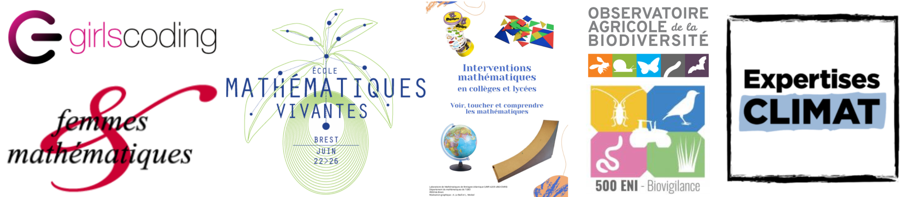

## Science communication

I see science as a powerful tool to explore and better understand the world around us. Throughout my career, I have enjoyed sharing my enthusiasm with diverse audiences through coding workshops (<a href="https://girlscoding.org/about-us/" class="dark-blue-link">Girls coding</a>), speed-meeting events (<a href="https://femmes-et-maths.fr/de-lecole-au-lycee/speed-meetings" class="dark-blue-link">Femmes&Mathématiques</a>), interactive mathematics workshops in Brest (<a href="https://www.lebesgue.fr/fr/MathsInter26" class="dark-blue-link">Mathématiques vivantes</a>, <a href="https://www.univ-brest.fr/laboratoire-mathematiques-bretagne-atlantique/fr/page/mathematiques-vivantes-0" class="dark-blue-link">Hands-on workshop</a>), and visits to my former school.

Beyond being a wonderful tool for satisfying our curiosity, science has also a key role to play in informing public debate and addressing misinformation. Working on a highly mediated topic such as pesticides has encouraged me to extend my activities beyond research, developing my skills in communicating with journalists (media training with <a href="https://expertisesclimat.fr/" class="dark-blue-link">Expertises Climat</a> and <a href="https://formation.ifsem.cnrs.fr/training/1832/5239" class="dark-blue-link">CNRS</a>) and making my research accessible to wider audiences (such as <a href="https://www.observatoire-agricole-biodiversite.fr/" class="dark-blue-link">OAB</a> and <a href="https://ecophytopic.fr/pic/exposition-et-impacts/reseau-500-eni-biovigilance" class="dark-blue-link">500ENI</a> networks).

  

